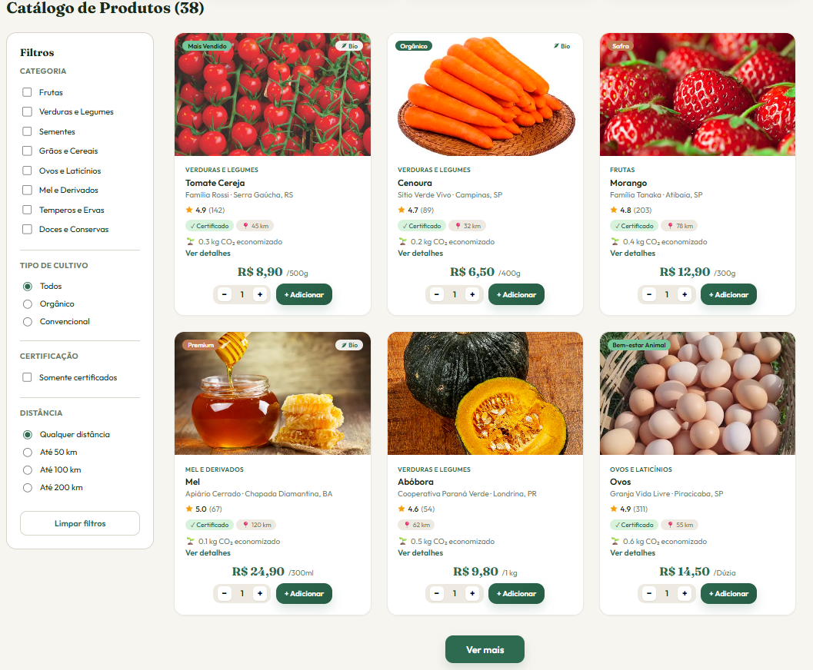
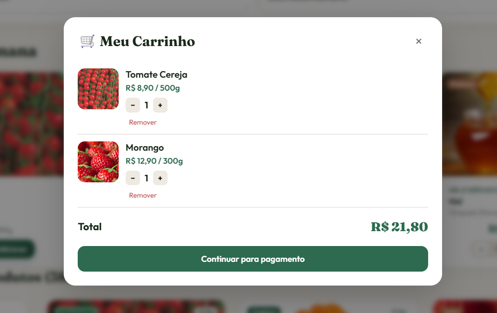
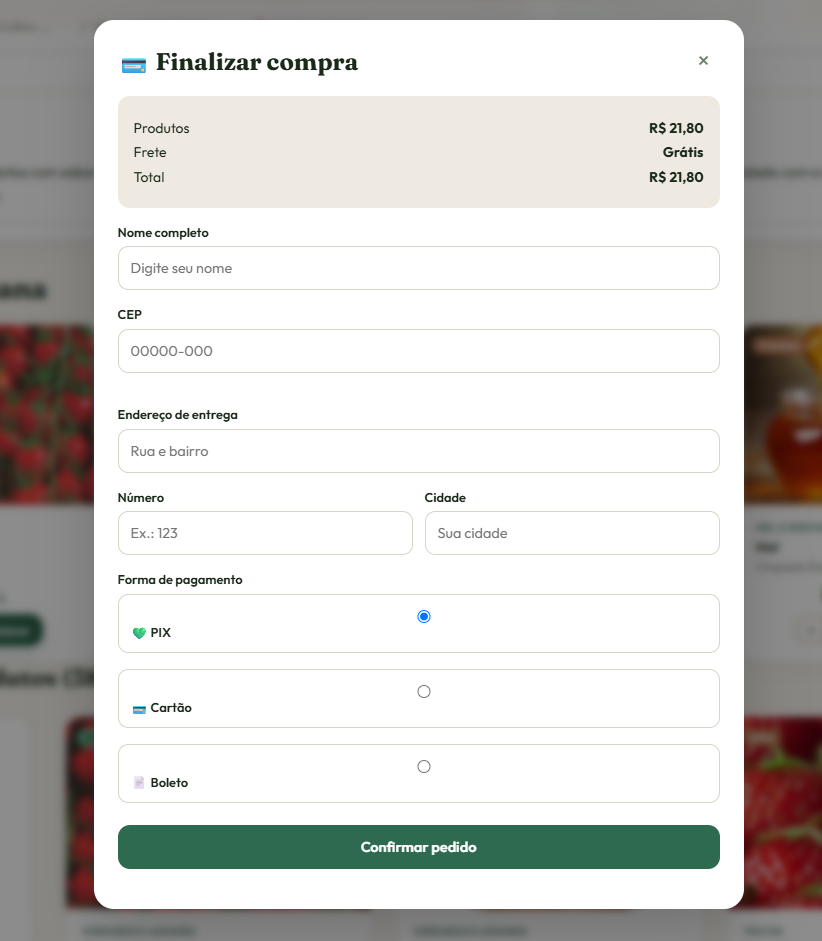
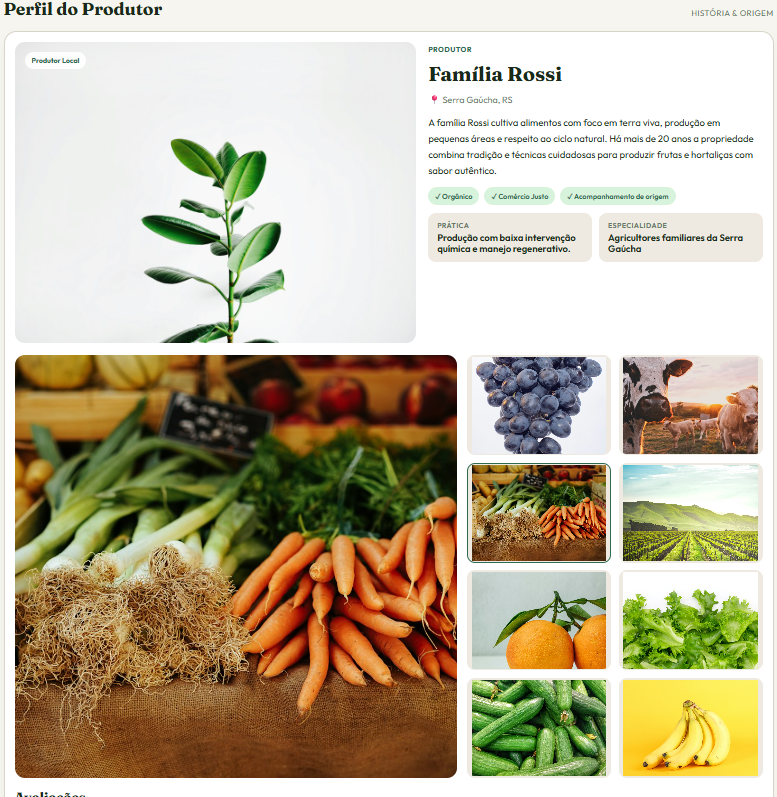
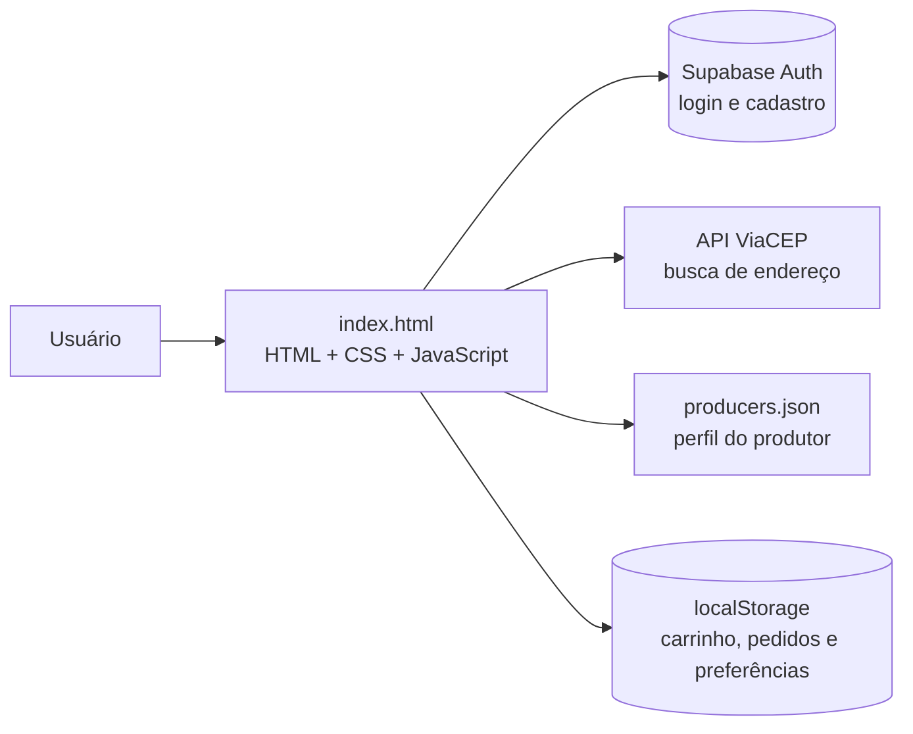

<p align="center">
  
</p>

<h1 align="center">CodeHorizon · Do Campo à Mesa</h1>

<p align="center">
  <strong>Conectando produtores rurais a consumidores de forma mais transparente e sustentável.</strong>
</p>

<p align="center">
  
  
</p>

<p align="center">
  
  
  
  
  
  
</p>

<p align="center">
  <a href="#identificação-acadêmica">Identificação acadêmica</a> ·
  <a href="#equipe">Equipe</a> ·
  <a href="#visão-geral">Visão geral</a> ·
  <a href="#funcionalidades">Funcionalidades</a> ·
  <a href="#capturas-de-tela">Capturas de tela</a> ·
  <a href="#como-executar">Como executar</a> ·
  <a href="#roadmap">Roadmap</a>
</p>

<p align="center">
  <br>
  <sub>Página inicial do CodeHorizon</sub>
</p>

<br>

<table align="center">
  <tr>
    <td align="center" width="25%"><h3>38</h3><sub>produtos regionais</sub></td>
    <td align="center" width="25%"><h3>8</h3><sub>categorias</sub></td>
    <td align="center" width="25%"><h3>3</h3><sub>formas de pagamento</sub></td>
    <td align="center" width="25%"><h3>100%</h3><sub>rastreável até o produtor</sub></td>
  </tr>
</table>

---

## Identificação acadêmica

| Item | Descrição |
|---|---|
| **Instituição de Ensino** | Uniceplac |
| **Curso** | Engenharia de Software |
| **Disciplina** | Projeto Integrado de Certificação em Governança e Gestão de TI |
| **Orientador** | Profº Hudson Neves |

---

## Equipe

| # | Integrante |
|:-:|---|
| 1 | Evellyn Marinho |
| 2 | Ana Luysa Paiva |
| 3 | João Gabriel Monteiro |
| 4 | Kaio Lucas de Lima |
| 5 | Lucas Barreira |
| 6 | Luigi Gomes |
| 7 | Luis Gustavo Cardoso |
| 8 | Samuel Cardoso |
| 9 | João Henrique Gomes |

---

## Sumário

- [Identificação acadêmica](#identificação-acadêmica)
- [Equipe](#equipe)
- [Visão geral](#visão-geral)
- [Funcionalidades](#funcionalidades)
- [Capturas de tela](#capturas-de-tela)
- [Tecnologias](#tecnologias)
- [Arquitetura](#arquitetura)
- [Como executar](#como-executar)
- [Estrutura do projeto](#estrutura-do-projeto)
- [Recursos em modo demonstração](#recursos-em-modo-demonstração)
- [Roadmap](#roadmap)
- [Licença](#licença)

---

## Visão geral

O CodeHorizon é uma plataforma web que aproxima pequenos produtores rurais e agricultores familiares dos consumidores finais. Ela facilita o acesso a produtos agrícolas regionais, valoriza a produção local e incentiva o consumo consciente.

Cada produto mostra o produtor, a região de origem, a distância até o consumidor e o CO₂ economizado, para que o cliente saiba de onde vem o que está comprando.

### Problema

- Falta de transparência sobre a procedência e os métodos de cultivo dos alimentos.
- Dificuldade de inserção e visibilidade de pequenos produtores no mercado digital.

### Para quem é

| Público | Descrição |
|---|---|
| 🌾 **Produtores** | Pequenos agricultores e famílias produtoras que buscam um canal direto de vendas. |
| 🛒 **Consumidores** | Pessoas que procuram alimentos frescos, orgânicos e regionais e priorizam o consumo sustentável. |

### Objetivo

> Conectar diretamente a produção agrícola familiar ao consumidor final, fortalecendo a economia local, valorizando a agricultura regional e simplificando a compra de alimentos de qualidade.

---

## Funcionalidades

### Vitrine e navegação

- **Banner interativo** com 4 slides e troca automática: apresentação da plataforma, Modo Sementes, seja um produtor parceiro e assinatura semanal.
- **Atalhos rápidos** para comprar, explorar sementes, vender e rastrear pedido.
- **Busca** por produto, produtor, região e categoria, sem diferenciar acentos.

### Catálogo de produtos

- **38 produtos** em 8 categorias: Frutas, Verduras e Legumes, Sementes, Grãos e Cereais, Ovos e Laticínios, Mel e Derivados, Temperos e Ervas, Doces e Conservas.
- **Filtros** na barra lateral e nos botões do topo: categoria, tipo de cultivo (orgânico ou convencional), somente certificados e distância (até 50, 100 ou 200 km).
- Produtos exibidos em **blocos de 6**, com o botão "Ver mais".
- Cada card mostra avaliação, selo de certificado, distância, CO₂ economizado, detalhes, escolha de quantidade e botão de adicionar ao carrinho.

### Safras da Semana

Seleção em destaque com os produtos da época, com os mesmos botões de quantidade e carrinho do catálogo.

### Perfil do produtor

História da família produtora, localização, selos (como Orgânico e Comércio Justo), práticas de cultivo, galeria de fotos e avaliações de compradores. Os dados vêm do arquivo `producers.json`; se ele não carregar, o site usa um perfil padrão.

### Compra

- **Carrinho** com alteração de quantidade e remoção de itens, salvo no navegador.
- **Checkout** com PIX, cartão ou boleto.
- **Busca de endereço pelo CEP**, usando a API pública ViaCEP.
- **Confirmação do pedido** com código, itens, forma de pagamento e total.

### Conta do usuário

- **Cadastro em 2 etapas:** dados da conta e, depois, nicho, tipo de conta (pessoal ou empresarial) e objetivo.
- **Login e cadastro** com Supabase Auth.
- **Minha Conta** com as abas Informações, Senha e segurança, Conexões, Meus pedidos, Equipe e Notificações.

### Suporte

- **Central de Ajuda** com canais de contato e perguntas frequentes.
- Rodapé com informações da plataforma e links para produtores.

---

## Capturas de tela

### Compra

<table>
  <tr>
    <td align="center" width="50%">
      <br>
      <sub><strong>Catálogo</strong> com busca e filtros</sub>
    </td>
    <td align="center" width="50%">
      <br>
      <sub><strong>Carrinho</strong> de compras</sub>
    </td>
  </tr>
  <tr>
    <td align="center" colspan="2">
      <br>
      <sub><strong>Checkout</strong> com busca de endereço pelo CEP</sub>
    </td>
  </tr>
</table>

### Produtor

<p align="center">
  <br>
  <sub><strong>Perfil do produtor:</strong> história da família, selos, práticas de cultivo, galeria e avaliações</sub>
</p>

### Acesso à plataforma

<table>
  <tr>
    <td align="center" width="50%">
      <br>
      <sub><strong>Login</strong> com Supabase Auth</sub>
    </td>
    <td align="center" width="50%">
      <br>
      <sub><strong>Cadastro</strong> em 2 etapas</sub>
    </td>
  </tr>
</table>

---

## Tecnologias

| Categoria | Tecnologias |
|---|---|
| **Frontend** | HTML5, CSS3 e JavaScript puro (sem frameworks) |
| **Autenticação** | Supabase Auth (biblioteca `supabase-js`) |
| **APIs externas** | ViaCEP, para busca de endereço pelo CEP |
| **Armazenamento no navegador** | localStorage (carrinho, pedidos e preferências) |
| **Dados do produtor** | Arquivo `producers.json` |
| **Fontes** | Google Fonts (Fraunces e Outfit) |
| **Versionamento** | Git e GitHub |

---

## Arquitetura



Hoje o Supabase cuida do login e do cadastro. Produtos, pedidos e carrinho ficam no próprio site e no navegador. A próxima etapa é mover esses dados para um banco de dados.

---

## Como executar

### Pré-requisitos

- Navegador atualizado
- Conexão com a internet (Supabase, fontes, imagens e ViaCEP)
- Editor de código, como o Visual Studio Code
- Extensão Live Server (recomendada)

### Instalação

```bash
git clone https://github.com/USUARIO/REPOSITORIO.git
cd REPOSITORIO
```

<!-- Troque USUARIO/REPOSITORIO pelo link real do repositório -->

### Execução

1. Abra a pasta do projeto no Visual Studio Code.
2. Abra o arquivo `index.html`.
3. Clique com o botão direito e escolha **Open with Live Server**.
4. O site abrirá no navegador.

> [!IMPORTANT]
> Use o Live Server porque o site carrega o `producers.json` com `fetch()`. Abrindo o HTML direto pelo explorador de arquivos, o navegador pode bloquear esse carregamento.

### Configuração do Supabase

No início do `index.html` ficam a URL do projeto e a chave **pública** (publishable).

> [!WARNING]
> Use somente a chave pública no frontend. Nunca coloque chaves secretas (`service_role`) no código do site.

---

## Estrutura do projeto

```text
CodeHorizon/
│
├── Fotos/
│   ├── Logo.jpeg
│   ├── Home.jpeg
│   ├── Catalogo.jpeg
│   ├── Carrinho.jpeg
│   ├── Checkout.jpeg
│   ├── Perfil-do-Produtor.jpeg
│   ├── Login.jpeg
│   └── Cadastro.jpeg
├── index.html
├── style.css
├── producers.json
└── README.md
```

<!-- Ajuste se o projeto tiver outras pastas ou arquivos -->

---

## Recursos em modo demonstração

> [!NOTE]
> Algumas partes ainda usam dados de exemplo e serão trocadas por integrações reais.

- Pagamento por PIX, cartão e boleto: nenhum valor é cobrado.
- Status dos pedidos: sorteado entre "Em preparo", "A caminho" e "Entregue".
- Conexões de conta (Google, WhatsApp e Instagram) e convites de equipe.
- Canais de contato da Central de Ajuda.
- Estatísticas e vantagens exibidas na página inicial.

---

## Roadmap

**Concluído**

- [x] Página inicial com banner interativo
- [x] Catálogo com 38 produtos, busca e filtros
- [x] Safras da Semana
- [x] Perfil do produtor
- [x] Carrinho e checkout
- [x] Busca de endereço pelo CEP
- [x] Login e cadastro com Supabase
- [x] Área Minha Conta

**Próximos passos**

- [ ] Banco de dados para produtos, pedidos e avaliações
- [ ] Área para o produtor cadastrar e editar os próprios produtos
- [ ] Pagamento real
- [ ] Acompanhamento real do status dos pedidos
- [ ] Troca de senha pela autenticação do Supabase
- [ ] Publicação do site online

---

## Licença

Todos os direitos reservados. © 2026 Equipe CodeHorizon.

<p align="center">
  <sub>Feito com dedicação para aproximar o campo da mesa. 🌱</sub>
</p>
